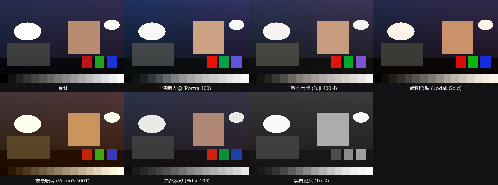

# FilmLook 胶片质感套件

为 ComfyUI 带来一套完整的胶片质感流程：胶片调色、LUT 应用、高光光晕（Halation）、物理胶片颗粒，以及一个把三者串起来的"一键胶片"节点。

设计原则：**技术参数藏进预设，界面只说人话**。曝光、高光检测、自然饱和度保护都默认自动完成，你只需要选风格、拉强度。

## 功能一览

| 节点 | 分类 | 作用 |
|---|---|---|
| FilmLook 胶片调色 | FilmLook/色彩 | 7 种胶片预设 + 亮度/对比度/饱和度/色温/色调手动微调 |
| FilmLook LUT 应用 | FilmLook/色彩 | 应用 `.cube` 或 HaldCLUT `.png` LUT 文件，可自定义路径 |
| FilmLook 光晕 (Halation) | FilmLook/光学 | 高光周围的红橙色雾圈，胶片标志性光学效果 |
| FilmLook 镜头质感 | FilmLook/光学 | 柔光（黑柔镜感）+ 暗角，两个滑杆 |
| FilmLook 胶片颗粒 | FilmLook/颗粒 | 基于 silvergrain 的物理银盐颗粒（非普通噪点） |
| FilmLook 一键胶片 | FilmLook | 调色 + 光晕 + 颗粒一次完成 |

## 安装

1. 把本文件夹整个复制到 `ComfyUI/custom_nodes/` 下（文件夹名保持 `comfyui-FilmLook`）。
2. 安装基础依赖（ComfyUI 一般已自带）：
   ```
   pip install -r requirements.txt
   ```
3. **手动安装颗粒引擎 silvergrain**（只有"胶片颗粒"和"一键胶片"节点需要）：
   ```
   pip install silvergrain[gpu]
   ```
   - 需要 NVIDIA CUDA 显卡才有实用速度。1024×1024 单帧实测（RTX 6000 Ada）：速度优先约 1 秒、均衡约 2 秒、画质优先约 3.6 秒；彩色颗粒约为亮度颗粒的 3 倍；CPU 约 159 秒。
   - silvergrain 采用 **AGPLv3** 开源协议，商用前请确认合规。
   - 不安装也不影响其余三个节点。
4. 重启 ComfyUI。

## 节点用法（各一句话）

- **胶片调色**：接入图像 → 选预设 → 调 `strength` 即可，其余参数默认就很稳。
- **LUT 应用**：把 `.cube` 或 HaldCLUT `.png` 文件放进插件的 `luts/` 文件夹后重启，在下拉框中选择；或选"自定义路径"并填完整路径。
- **光晕**：默认自动检测高光，只调 `strength` 和 `radius` 两档就够。
- **镜头质感**：两个滑杆——柔光（黑柔镜感）与暗角，可以单独用在任何图像上。
- **胶片颗粒**：选颗粒粗细（ISO）→ 选亮度/彩色颗粒 → 完成。建议 GPU 环境使用。
- **一键胶片**：选预设和颗粒档位即可出片，适合批量出图。

## 参数说明

### FilmLook 胶片调色

| 参数 | 默认 | 说明 |
|---|---|---|
| preset | 清新人像 (Portra 400) | 胶片风格预设，详见下方预设表 |
| strength | 0.85 | 效果强度，0 为原图 |
| auto_exposure | 开 | 智能曝光：自动把整体亮度校正到胶片友好区间 |
| brightness | 0 | 亮度，+1 约提亮一档，-1 约压暗一档 |
| contrast | 1.0 | 对比度，1 保持不变 |
| saturation | 1.0 | 自然饱和度；提升时只加在颜色本来就淡的地方，已鲜艳的部分几乎不动，肤色不易过曝 |
| temperature | 0 | 色温：负偏冷（蓝），正偏暖（黄）；满行程约 ±65 mired（等效色温 6500K → 4600K / 11600K） |
| tint | 0 | 色调：负偏绿，正偏品红；与色温同量级，只改色相不改亮度，中灰亮度守恒 |
| preserve_luminance | 0 | 亮度保持：0 允许 LUT 自由改变亮度，1 输出亮度完全贴回原图；遇到过曝时调高 |
| style_boost | 1.0 | 风格浓度：1 为忠实 LUT 效果，>1 把风格放大到超出真实胶片 |

### 胶片预设速查

**预设就是一条 3D LUT。** 节点把 `.cube` 直接应用到画面，不再用参数化模型去逼近——拟合会丢掉 LUT 的性格：实测用 12 参数模型逼近参考 LUT，765 色板平均偏差 0.04~0.08、95 分位最高 0.25，Vision3 500T 的天空色度被从 0.235 放大到 0.559（2.4 倍）。改为直接查表后，预设输出与参考 LUT 的差异是 1e-7（浮点噪声）。LUT 本体放在 `presets/`，来源与许可（含 CC BY-SA 提示）见 `presets/LICENSE.md`。



> 同一张合成场景过一遍各预设（`strength=1`、参数全默认）。场景里刻意放了胶片最敏感的四样东西：中性灰墙面看黑位与色偏、肤色块看肤色是否发灰、路灯看高光滚降、底部灰阶看反差与暗部层次。图由 `tools/make_preset_sheet.py` 生成。

下表的「实测性格」不是照胶片名声写的，而是量出来的（`tests/preset_character_test.py` 会把这张表当契约校验，换 LUT 或改管线都会让它失败）：

| 预设 | 实测性格 | 色度/原图 | 暖度 R−B | LUT 文件 | 来源 |
|---|---|---|---|---|---|
| 清新人像 (Portra 400) | 低反差、轻微降饱和，色调近中性 | 0.81× | +0.01 | `presets/portra_400.cube` | G'MIC（CC BY-SA） |
| 日系空气感 (Fuji 400H) | 低饱和、通透，中调偏暖 | 0.77× | +0.07 | `presets/fuji_400h.cube` | G'MIC（CC BY-SA） |
| 暖阳金调 (Kodak Gold) | 暖调，彩色预设里反差与饱和最高 | 1.06× | +0.04 | `presets/kodak_gold_200_warm.cube` | dazz-retro-camera（MIT） |
| 夜景暖调 (Vision3 500T) | 明显偏暖、中等饱和；路灯/夜景最对味 | 0.91× | **+0.16** | `presets/vision3_500t.cube` | poptechstudio（MIT） |
| 自然淡彩 (Ektar 100) | 色调中性偏冷，比原图更淡；日常/静物 | 0.79× | +0.02 | `presets/ektar_100.cube` | G'MIC（CC BY-SA） |
| 黑白纪实 (Tri-X) | 高反差黑白，灰轴中性 | — | 0.00 | `presets/trix_400.cube` | G'MIC（CC BY-SA） |
| 自定义 | 不做 LUT 变换 | 1.00× | 0.00 | 无（直通） | — |

> **关于改名**：早先这两个预设叫「冷调电影感 (Vision3 500T)」和「浓郁鲜艳 (Ektar)」，但实测下来前者是**全套最暖**（R−B +0.16，因为 500T 是钨丝平衡胶片，蓝色夜空会变褐——那是钨丝片的正常表现，不是 bug）、后者**比原图更淡**（0.79×）。名不副实会误导用户，因此按实测改名。
>
> **旧工作流不会坏**：旧名字仍在 `film_stocks.LEGACY_PRESETS` 里做了映射，节点用 `VALIDATE_INPUTS` 放行旧名，输出与改名后逐像素一致。


### FilmLook LUT 应用

支持两种格式：标准 `.cube`（LUT_1D_SIZE / LUT_3D_SIZE）和 **HaldCLUT `.png`**（8/16-bit RGB，level 自动识别）。

`luts/` 是自带的 LUT 库（默认 125 个 `.cube`，可自由增删），下拉框会自动列出该目录下的全部文件。**其中大半是 `Essential LUT 07` 这类看不出内容的编号名**。跑一次 `python tools/index_luts.py` 会在 `luts/README.md` 生成一份索引，把每个 LUT 的冷暖（R−B）、饱和（相对原图倍数）、反差都量出来并按暖度排序，想找「偏冷、低饱和」的直接按数值挑，不用一个个试。（索引是本地产物、不入库——`luts/` 里只有 6 个 MIT 参考 LUT 随仓库分发，其余是你自己的收藏。）**这个目录里的文件是用户自行收集的，来源与许可由收集者负责**，与本插件的预设无关；预设用的 6 条 LUT 单独放在 `presets/`，许可见 `presets/LICENSE.md`。

| 参数 | 默认 | 说明 |
|---|---|---|
| lut | luts 里排第一的文件 | luts 文件夹中的所有 `.cube` / `.png` 文件 + 自定义路径（文件夹为空时默认落在“自定义路径”） |
| strength | 1.0 | 效果强度，0 为原图 |
| custom_path | （空） | 选择"自定义路径"时填写的 `.cube` / `.png` 完整路径 |

### FilmLook 光晕 (Halation)

| 参数 | 默认 | 说明 |
|---|---|---|
| strength | 0.5 | 光晕强度 |
| radius | 标准 | 光晕范围：轻微 / 标准 / 明显 / 夸张 |
| auto_threshold | 开 | 自动检测画面高光区域 |
| threshold | 0.85 | 手动高光阈值，仅关闭自动检测时生效，越低光晕区域越多 |

### FilmLook 胶片颗粒

| 参数 | 默认 | 说明 |
|---|---|---|
| grain_level | 标准 (ISO 400) | 颗粒粗细：极细 (ISO 100) → 极粗 (ISO 3200) |
| grain_type | 亮度颗粒 (保色彩) | 亮度颗粒保色彩；彩色颗粒更有胶片味但会轻微偏色 |
| strength | 1.0 | 颗粒强度 |
| quality | 均衡 | 渲染质量：速度优先 / 均衡 / 画质优先 |
| sharpen | 0.3 | 锐度补偿：颗粒的光学特性会轻微柔化画面，此项加回线条锐度；0 关闭 |
| seed | 0 | 随机种子；同一批次每帧自动重新采样，视频不会出现"静止颗粒" |

### FilmLook 镜头质感

两个滑杆，模拟老镜头的光学缺陷。默认值都足够轻，**可以单独用在任何图像上**，不依赖其它节点。

| 参数 | 默认 | 说明 |
|---|---|---|
| diffusion | 0.25 | 柔光强度：高光向周围弥散，模拟黑柔镜/柔焦滤镜；0 关闭 |
| vignette | 0.25 | 暗角强度：四角向中心压暗，引导视线；0 关闭 |

> 柔光的模糊尺度按画面短边计算，**竖幅和横幅的观感一致**（早期版本按高度算，竖图会强 1.8 倍）。
> 暗角以像素中心为坐标，1×1、512×1 这类极端形状也不会偏向一角。

### FilmLook 一键胶片

| 参数 | 默认 | 说明 |
|---|---|---|
| preset | 清新人像 (Portra 400) | 同"胶片调色" |
| grain_level | 标准 (ISO 400) | 同"胶片颗粒" |
| strength | 0.85 | 整体强度，同时作用于调色与颗粒 |
| halation_strength | 0.4 | 光晕强度（标准范围、自动检测高光） |
| auto_exposure | 开 | 智能曝光（含高光保护）；画面过曝时可关闭 |
| preserve_luminance | 0.5 | 亮度保持：0 自由改变亮度，1 亮度完全贴回原图；遇到过曝时调高 |
| style_boost | 1.0 | 风格浓度：1 为忠实 LUT 效果，>1 把风格放大到超出真实胶片 |
| diffusion | 0.2 | 柔光强度：高光弥散的柔焦感（黑柔镜效果），0 关闭 |
| vignette | 0.2 | 暗角强度：四角向中心压暗，0 关闭 |
| seed | 0 | 随机种子 |

## 常见问题

**Q：运行"胶片颗粒 / 一键胶片"时报错，提示缺少 silvergrain 库？**
A：在 ComfyUI 使用的 Python 环境里运行 `pip install silvergrain[gpu]` 后重启 ComfyUI。便携版通常是：
```
D:\ComfyUI_windows_portable\python_embeded\python.exe -m pip install silvergrain[gpu]
```
没有 NVIDIA 显卡可以装 CPU 版（`pip install silvergrain`），但非常慢，请做好心理准备。

**Q：LUT 下拉框里没有我的文件？**
A：确认文件扩展名是 `.cube` 或 `.png`（HaldCLUT）、放在插件的 `luts/` 文件夹里，然后重启 ComfyUI（或刷新节点定义）。16-bit HaldCLUT 只支持非隔行扫描的 RGB/RGBA PNG。16-bit HaldCLUT 首次加载较慢（12 级 1728² 约 10 秒），解析结果会按文件修改时间缓存，之后再次使用是瞬时的。

**Q：颗粒在视频批次里每帧都一样吗？**
A：不会。每一帧都用 `seed` 与帧号派生出的独立种子重新渲染（第 N 帧的种子由 `seed` 和 `N` 雪崩混合而来，不是简单相加——silvergrain 的图案对相邻种子只是平移一个 cell，直接相加会得到几乎同一张图），彩色颗粒模式下三个通道也各用独立种子，符合真实胶片颗粒"时间独立"的特性。

## 开发与测试

所有测试都用 ComfyUI 自带的 Python 直接跑（不需要额外依赖）：

```bash
python tests/smoke_test.py              # 六个节点跑通、形状/值域/NaN
python tests/param_direction_test.py    # 色温/色调的方向、互反、亮度守恒
python tests/node_contract_test.py      # 节点注册表/签名/默认值/返回声明的一致性
python tests/preset_character_test.py   # 预设描述与实测性格一致（文档即契约）
python tests/grain_test.py              # 颗粒 seed 生效、逐帧/逐通道独立、强度 0 恒等
python tests/edge_case_test.py          # 极端形状/超大图/参数边界/暗角与光晕几何
python tests/readme_drift_test.py       # README 参数表与节点真实输入双向一致
python tests/luts_index_test.py         # luts/README.md 索引与目录、实测数值一致
python tests/generator_test.py          # LUT 生成器：通道朝向、灰阶单调、写读往返
python tests/audit_quality.py           # 性能、显存、极端输入（需 CUDA）
python tests/demo_render.py             # 非测试：把合成场景跑一遍各预设，出 PNG 供目检
```

`tools/` 下是离线工具，不参与运行时：`gen_film_luts.py`（从胶片数据手册生成 LUT，实验性，状态见文件头）、`index_luts.py`（重新生成 `luts/README.md` 索引）、`make_preset_sheet.py`（重新生成 `docs/presets.png` 预设对照图）。

## 许可

本插件代码可自由使用与修改；颗粒功能依赖的 silvergrain 为 **AGPLv3** 协议，集成或商用时请注意其传染性条款。

`presets/` 下 6 条预设 LUT 的**来源与许可各不相同**（4 条 G'MIC/Pat David 集为 CC BY-SA，2 条 MIT），逐条说明与署名要求见 [`presets/LICENSE.md`](presets/LICENSE.md)。要公开分发本插件，请先确认这 4 条 CC BY-SA 数据是否满足署名与相同方式共享的要求；插件代码本身不受影响。

`luts/` 目录是用户自行收集的 LUT 库，与本插件的预设无关——其来源与许可由收集者负责。胶片预设与任何胶片厂商无关。

## 路线图

- [x] **A**：预设改为直接应用 LUT（已完成）。
- [ ] **B**：用 `spectral_film_lut`（MIT）的**方法论**从胶片数据手册自己生成 LUT，替换现有数据源，使"名称与数据同源"。
  - [x] 链路打通：负片（Portra 400 / Pro 400H / Gold 200 / 5219 / Ektar 100）+ 印片 **Kodak 2383**，走 `特性曲线 → 密度 → 印片 → 投影 → XYZ → LUT`，代码见 `tools/gen_film_luts.py`，数据见 `tools/filmdata/`（MIT，已附署名）。
  - [x] 5 支彩色胶片能生成互不相同、物理合理的黑位与高光；高光软滚降、通道朝向自检、写读往返测试齐备。
  - [x] **结论**：这条"负片 + 2383 放映拷贝"路线与 `presets/` 里那条（更像负片扫描）**定位不同**——生成结果反差 0.81 vs 参考 0.43、暖度 +0.17 vs +0.01，且 5 支胶片的暖度只差 0.04（印片阶段盖过了胶片个性）。因此它不适合直接替换 `presets/`。
  - [ ] 若继续 B：改走"负片 → 扫描"路线，并移植 barycentric NNLS 谱上采样（治本），否则复刻不出参考 LUT 的性格。
  - [ ] 若不继续 B：按实测把预设中文名改准（`夜景暖调` 实际最暖、`自然淡彩` 实际比原图淡）——纯文案改动，但会破坏已保存的工作流，需要确认。

